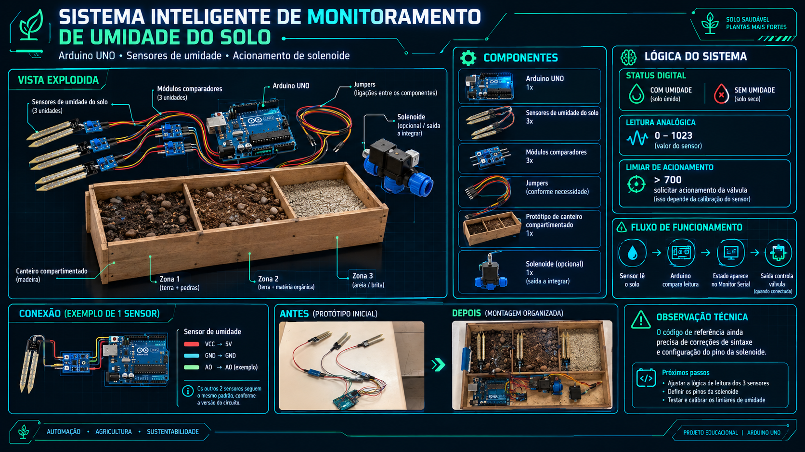
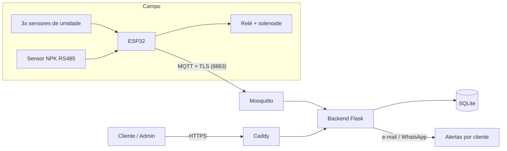

# 🌱 Monitoramento Inteligente de Solo

Plataforma de monitoramento de solo em tempo real: um dispositivo **ESP32** lê a **umidade** (3 zonas) e os **nutrientes N, P e K** (sensor RS485), envia os dados por **MQTT com TLS** para um backend **multi-cliente** e avisa por **e-mail ou WhatsApp** quando o solo seca ou os nutrientes caem. Opcionalmente, aciona uma **válvula solenoide** para irrigar.

> **Status: protótipo / MVP.** A lógica do backend foi testada com dados simulados. O firmware, o broker em Docker e os envios reais de e-mail e WhatsApp ainda precisam ser validados em bancada. Veja [Estado dos testes](#-estado-dos-testes).



## Sumário

- [Visão geral](#-visão-geral)
- [Arquitetura](#-arquitetura)
- [Estrutura do repositório](#-estrutura-do-repositório)
- [Hardware](#-hardware)
- [Firmware](#-firmware)
- [Backend e dashboard](#-backend-e-dashboard)
- [Subindo em uma VPS](#-subindo-em-uma-vps)
- [Configuração](#-configuração)
- [API](#-api)
- [Segurança](#-segurança)
- [Estado dos testes](#-estado-dos-testes)
- [Limitações conhecidas](#-limitações-conhecidas)
- [Roadmap](#-roadmap)

## 🔎 Visão geral

| Recurso | Descrição |
|---|---|
| Umidade do solo | 3 sensores analógicos por dispositivo (zonas); média usada para decidir irrigação e alertas |
| Nutrientes N, P, K | Leitura real por sensor NPK **RS485/Modbus RTU** (mg/kg), mais pH, EC e temperatura |
| Irrigação | Relé + solenoide com **histerese**, para não ligar e desligar sem parar |
| Comunicação | MQTT sobre **TLS** (porta 8883), usuário e senha por dispositivo, *Last Will* para detectar queda |
| Multi-cliente | Cliente → fazendas → dispositivos. Cada cliente vê só os seus dados |
| Alertas | Solo seco, NPK baixo, falha do sensor NPK e dispositivo offline, por e-mail (SMTP) e WhatsApp (Twilio) |
| Limites por dispositivo | Cada cliente ajusta os mínimos de umidade, N, P e K no dashboard |
| Deploy | `docker compose` com Mosquitto, backend (gunicorn) e Caddy (HTTPS automático) |

### ⚠️ Sobre a medição de nutrientes

Sensores de umidade (resistivos ou capacitivos) **não medem nutrientes**. Neste projeto, N, P e K vêm de um **sensor NPK dedicado (RS485/Modbus)**. Esses sensores de baixo custo são bons para acompanhar **tendência e variação**, mas têm precisão limitada e sofrem influência da umidade, da temperatura e do tipo de solo. Antes de usar os números para decisões de adubação, **compare com análise de laboratório** e calibre por tipo de solo.

As versões anteriores do projeto *estimavam* N, P e K com modelos *random forest* a partir de temperatura, umidade, pH, chuva e cultura. Isso é uma recomendação, não uma medição, e foi retirado do fluxo principal.

## 🏗️ Arquitetura



Fluxo: o ESP32 publica um JSON a cada 5 segundos em `solo/<zona>/leitura`. O backend só grava leituras de dispositivos **cadastrados** e confere se o tópico bate com a zona do cadastro. Assim, um dispositivo não consegue se passar por outro.

## 📁 Estrutura do repositório

```
.
├── firmware/
│   ├── esp32_npk_solo/            # firmware de produção (ESP32 + NPK + MQTT/TLS)
│   └── arduino_uno_prototipo/     # protótipo inicial (Arduino UNO, saída serial)
├── backend/
│   ├── app.py                     # Flask: login, admin, API, entrada MQTT
│   ├── alertas.py                 # regras de alerta e envio (e-mail / WhatsApp)
│   ├── templates/                 # login, dashboard, admin
│   ├── mosquitto/                 # configuração do broker (TLS + ACL)
│   ├── caddy/Caddyfile            # HTTPS automático
│   ├── scripts/                   # geração de certificados e usuários MQTT
│   ├── Dockerfile
│   ├── docker-compose.yml
│   └── .env.example
└── docs/
```

## 🔧 Hardware

| Item | Observação |
|---|---|
| ESP32 (DevKit) | Wi-Fi nativo |
| Sensor NPK RS485 (Modbus RTU) | Alimentação 12–24 V; confira baud, endereço e registradores no datasheet |
| Módulo MAX3485 (ou MAX485) | Prefira o MAX3485 (3,3 V); com MAX485 de 5 V, use conversor de nível na linha RO |
| 3 sensores de umidade do solo (saída analógica) | Calibre `ADC_SECO` e `ADC_MOLHADO` |
| Módulo relé + válvula solenoide (opcional) | Fonte própria e diodo de proteção; **nunca** ligue a válvula direto no pino |

**Ligações (ESP32)**

| Função | Pino |
|---|---|
| RS485 RX (RO) / TX (DI) | GPIO16 / GPIO17 |
| RS485 DE+RE (juntos) | GPIO4 |
| Umidade zonas 1, 2 e 3 | GPIO34, GPIO35, GPIO32 (ADC1; o ADC2 não funciona com Wi-Fi) |
| Relé da solenoide | GPIO26 |

O GND do sensor NPK deve ser comum com o do ESP32.

## 📟 Firmware

**`firmware/esp32_npk_solo`**

1. Instale na Arduino IDE o suporte à placa ESP32 e as bibliotecas **ModbusMaster** (Doc Walker) e **PubSubClient** (Nick O'Leary).
2. Edite as constantes no topo do arquivo: Wi-Fi, `MQTT_HOST`, `MQTT_USER`, `MQTT_PASS`, `DEVICE_ID`, tópicos e `CA_CERT` (conteúdo do `ca.crt` gerado no deploy).
3. Confira o mapa de registradores Modbus do **seu** sensor (`MODBUS_*` e `REG_*`). O padrão assume um sensor 7 em 1 comum: baud 4800, endereço 1, registradores `0x0000` a `0x0006`.
4. Calibre `ADC_SECO` (sensor no ar) e `ADC_MOLHADO` (sensor na água).
5. Grave na placa e acompanhe a serial (115200).

Comportamento: lê a cada 5 s; irriga quando a média das zonas fica abaixo de 35% e para acima de 45%; se o sensor NPK falhar, publica `npk_ok: 0` e a irrigação continua guiada só pela umidade. A conexão TLS valida o certificado do broker, por isso o firmware sincroniza a hora por NTP.

> Nunca grave senhas reais no Git. Mantenha credenciais fora do repositório.

**`firmware/arduino_uno_prototipo`**: versão didática com 3 sensores (A0–A2), solenoide no pino 7, histerese e saída JSON pela serial. Não tem rede.

## 🖥️ Backend e dashboard

- **Login** por e-mail e senha (hash), sessão de 8 h, proteção CSRF e bloqueio após 5 tentativas erradas.
- **Painel `/admin`** (só admin): cria clientes (com login e contatos de alerta), fazendas e dispositivos.
- **Dashboard**: cards de solo seco/úmido, umidade, N, P, K, pH e válvula; gráficos de 1 h, 24 h e 7 dias; lista dos últimos alertas; edição dos limites de alerta do dispositivo.

### Regras de alerta

| Alerta | Quando dispara |
|---|---|
| `SOLO_SECO` | Média das últimas 3 leituras abaixo do mínimo de umidade |
| `NPK_BAIXO` | Média das últimas 5 leituras válidas de N, P ou K abaixo do mínimo |
| `NPK_FALHA` | 10 leituras seguidas sem resposta do sensor NPK |
| `OFFLINE` | Sem dados há mais de 5 min, ou `offline` no tópico de status (*Last Will*) |

Cada tipo, por dispositivo, só dispara de novo após 60 min (configurável). Mínimo `0` desativa o alerta daquele item. Os limites padrão de N, P e K são **exemplos**: ajuste por cultura e solo, com orientação agronômica.

## 🚀 Subindo em uma VPS

Pré-requisitos: Docker com Compose, um domínio apontando para a VPS e as portas **80, 443 e 8883** abertas.

```bash
cd backend
cp .env.example .env            # preencha DOMINIO, SECRET_KEY (openssl rand -hex 32) e demais variáveis

bash scripts/gen-certs.sh solo.seudominio.com.br      # CA própria + certificado do broker
bash scripts/novo-usuario.sh backend                  # anote a senha e coloque em MQTT_BACKEND_PASS no .env

docker compose up -d --build

docker compose exec backend flask --app app criar-admin voce@empresa.com
```

Depois:

1. Acesse `https://SEU_DOMINIO/admin` e cadastre cliente, fazenda e dispositivo. O **id** deve ser igual ao `DEVICE_ID` do firmware e a **zona** igual ao tópico `solo/<zona>/leitura`.
2. Crie o usuário MQTT da placa: `bash scripts/novo-usuario.sh esp32-solo-01 zona1`.
3. Cole o `mosquitto/certs/ca.crt` em `CA_CERT` no firmware e grave a placa.

**Cuidados**
- Guarde o arquivo `ca.key.GUARDE-FORA-DO-SERVIDOR` **fora** da VPS. Quem tiver essa chave emite certificados que o firmware aceita.
- O certificado do broker vale 730 dias. Se vencer, os dispositivos param de conectar; agende a renovação.
- Faça backup periódico do volume `dados` (histórico de leituras e alertas).

## ⚙️ Configuração

Principais variáveis do `.env` (lista completa em [`backend/.env.example`](backend/.env.example)):

| Variável | Para quê |
|---|---|
| `DOMINIO` | Domínio do HTTPS (Caddy) |
| `SECRET_KEY` | Chave das sessões de login (obrigatória) |
| `MQTT_BACKEND_PASS` | Senha do usuário `backend` no broker |
| `SMTP_HOST`, `SMTP_PORT`, `SMTP_USER`, `SMTP_PASS` | Envio de e-mail |
| `TWILIO_SID`, `TWILIO_TOKEN`, `TWILIO_WHATSAPP_FROM` | Envio de WhatsApp (Twilio) |
| `ALERT_EMAIL_TO`, `ALERT_WHATSAPP_TO` | Destinatários de reserva, usados quando o cliente não tem contatos |
| `ALERTA_UMID_MIN`, `ALERTA_N_MIN`, `ALERTA_P_MIN`, `ALERTA_K_MIN` | Limites padrão |
| `ALERTA_COOLDOWN_MIN` | Intervalo mínimo entre alertas repetidos |
| `API_KEY` | Habilita `POST /api/leitura` (só para testes) |

Para WhatsApp em uso comercial é preciso um número aprovado e templates liberados pela Meta.

## 🔌 API

Todas as rotas exigem login, exceto `/login` e `/api/leitura`, e retornam apenas dados dos dispositivos do usuário.

| Rota | Descrição |
|---|---|
| `GET /api/dispositivos` | Dispositivos visíveis ao usuário |
| `GET /api/ultima?device=ID` | Última leitura |
| `GET /api/historico?device=ID&horas=24` | Série histórica |
| `GET /api/alertas` | Últimos alertas |
| `GET /api/limites?device=ID` | Limites efetivos e padrão |
| `POST /api/limites` | Salva (`{"device","limites":{...}}`) ou restaura (`{"device","restaurar":true}`); exige cabeçalho `X-CSRF` |
| `POST /api/leitura` | Ingestão HTTP para testes; exige `X-API-Key`; desativada se `API_KEY` estiver vazia |

Payload publicado pelo ESP32:

```json
{"id":"esp32-solo-01","z":[32,35,30],"umid_media":32,"solo":"UMIDO","valvula":0,
 "npk_ok":1,"n":42,"p":18,"k":120,"ph":6.4,"ec":300,"temp":24.5,"umid_sensor":33.1}
```

## 🔒 Segurança

- MQTT somente com TLS, sem acesso anônimo, ACL por dispositivo (cada placa só publica nos próprios tópicos; o `backend` só lê).
- Isolamento entre clientes: acessar dado de dispositivo alheio retorna 404.
- Verificação de tópico × zona cadastrada contra falsificação de dispositivo.
- Senhas com hash, cookies `HttpOnly`/`SameSite`/`Secure`, CSRF e limite de tentativas de login.
- O `.gitignore` já exclui `.env`, bancos de dados, senhas do broker e chaves.

## 🧪 Estado dos testes

**Testado (com dados simulados, no ambiente de desenvolvimento):** gravação e consulta de leituras, regras de alerta e controle de repetição, isolamento entre clientes, login, CSRF, limite de tentativas, bloqueio de dispositivo falsificado, edição de limites e geração dos certificados.

**Ainda não validado:** compilação e execução do firmware no ESP32 com o sensor NPK real; conexão TLS com um broker real; `docker compose up`; envio real de e-mail e WhatsApp; o dashboard em navegador; e a ingestão MQTT de ponta a ponta.

## ⚠️ Limitações conhecidas

- Sem recuperação de senha por e-mail (o admin recria o usuário).
- Limite de tentativas de login em memória (zera a cada reinício).
- SQLite atende poucos clientes; com crescimento, migrar para PostgreSQL.
- Sem histórico de alterações dos limites de alerta.
- A chave de `POST /api/leitura` é única; em produção, a entrada de dados é pelo MQTT.
- Precisão dos sensores NPK de baixo custo exige calibração e validação em laboratório.

## 🗺️ Roadmap

- [ ] Recuperação de senha por e-mail
- [ ] Predefinições de limites por cultura (com fonte agronômica)
- [ ] Registro de alterações de limites e de ações no painel
- [ ] Migração para PostgreSQL/TimescaleDB
- [ ] Calibração de N, P e K contra análise de laboratório
- [ ] OTA para atualizar o firmware
- [ ] Camada de recomendação de adubação (modelo de ML sobre dados medidos)
- [ ] App mobile

## 📄 Licença

A definir.

## 👤 Autor

**Alexsander** ([@alexsander020](https://github.com/alexsander020)), estudante de Ciência da Computação na FECAP.
